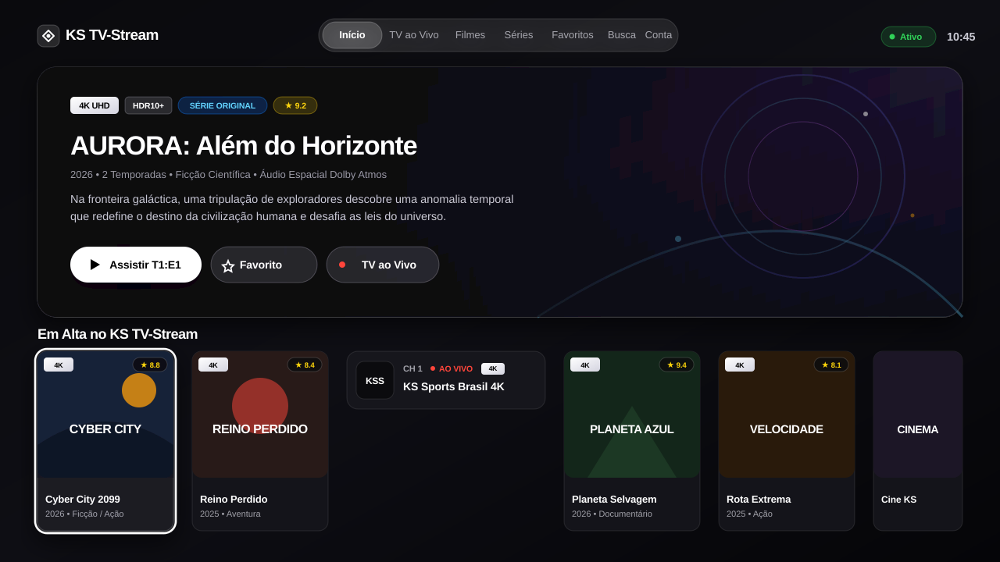
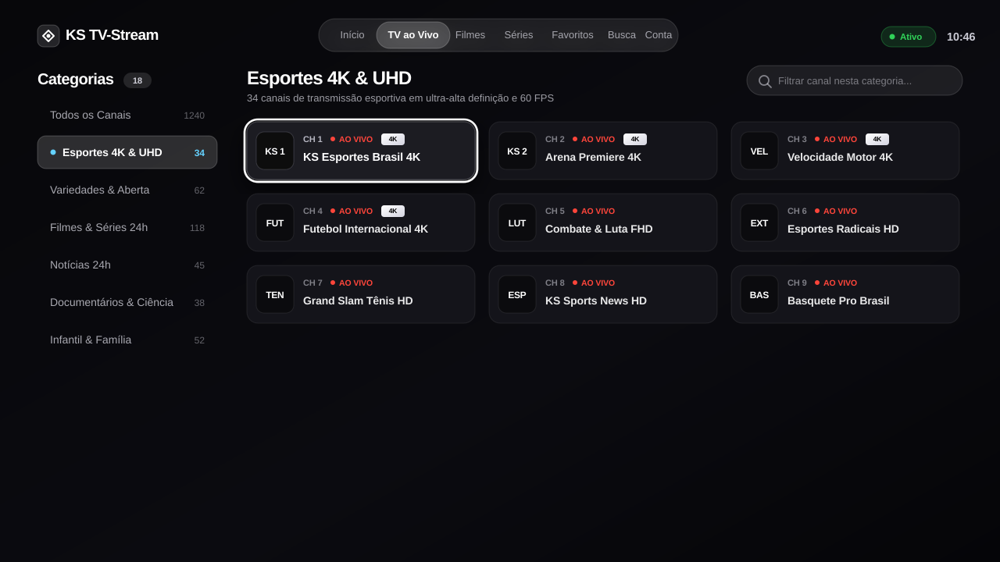
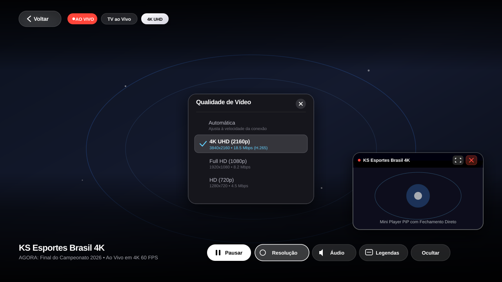

# KS TV-Stream — Fire TV Stick 4K, Android TV & Web

<p align="center">
  
</p>

<p align="center">
  <b>Player de IPTV minimalista inspirado no tvOS (Apple TV)</b><br>
  Projetado para máxima performance a <b>60 FPS</b> no <b>Amazon Fire TV Stick 4K</b>, <b>Google TV / Android TV</b> e no <b>navegador web</b>.
</p>

<p align="center">
  
  
  
  
  
</p>

---

## 📸 Demonstração da Interface (Simulações 100% Livres de Copyright)

### 1. Vitrine Principal & Destaques em 4K
Interface inspirada no **Apple TV+ Top Shelf**, com foco dinâmico, proporção cinematográfica `2:3` e badges luminosos automáticos de **4K UHD** e **HDR**.

<p align="center">
  
</p>

---

### 2. TV ao Vivo — Sidebar de Categorias & Grade de Canais
Navegação instantânea com **0ms de atraso**, troca sob demanda por categoria (`&category_id`), indicador `AO VIVO`, numeração organizada e anel de foco luminoso Apple TV sem lavar as cores da capa.

<p align="center">
  
</p>

---

### 3. Player "Clear", Menu de Faixas e Mini Player (PiP)
Controles completos com menu popover estilo Apple TV+ para seleção de **Resolução** (multi-bitrate HLS e variantes), **Áudio** (Dublado/Legendado/Dual), **Legendas** (embutidas e importação local de `.srt` / `.vtt`), além do **Mini Player flutuante com botão direto de fechar (✕)**.

<p align="center">
  
</p>

---

## ✨ Principais Diferenciais e Funcionalidades

1. **Estética Apple tvOS & Liquid Glass**:
   - Barra de navegação em cápsula flutuante (`Início`, `TV ao Vivo`, `Filmes`, `Séries`, `Favoritos`, `Busca`, `Conta`).
   - Motor de foco com aceleração por hardware (60 FPS) e contorno luminoso de 2.5px.
   - Pôsteres cinematográficos em alta definição com badge **4K** automático para conteúdos UHD/2160p.

2. **Qualidade de Vida (QoL) no Player**:
   - **Botão `‹ Voltar` no Player**: Permite encolher a TV ao Vivo para o Mini Player ou sair do filme com um clique no navegador ou controle.
   - **Botão `‹ Voltar` nas Páginas de Séries e Filmes**: Barra superior fixa para retornar instantaneamente à tela anterior sem depender da tecla Esc.
   - **Menu Popover de Faixas**:
     - **Resolução**: Alterna entre qualidades (4K, 1080p, 720p, Automática) mantendo o ponto exato da reprodução no VOD.
     - **Áudio**: Seleção de canais de áudio e versões alternativas (*Dublado*, *Legendado*, *Dual*).
     - **Legendas**: Exibição de legendas do fluxo, desativação e botão direto para carregar arquivos locais (`.srt` / `.vtt`).
   - **Mini Player com Fechamento Direto**: Botão `✕` no canto da janela flutuante para encerrar o stream em 1 clique.

3. **Arquitetura Ultra Leve para Listas Gigantes (+75.000 itens)**:
   - Paginação sob demanda e cache inteligente em memória RAM (sem engasgar a memória do Fire TV Stick).
   - Busca global ultra-rápida varrendo Canais, Filmes e Séries simultaneamente.

4. **3 Formas de Conexão**:
   - **Xtream Codes API**: Conexão nativa com Servidor, Usuário e Senha.
   - **Acesso Rápido**: Conexão direta por DNS/IP.
   - **Listas M3U / M3U Plus**: Importação direta de URLs M3U ou SSIPTV.

---

## 🚀 Como Compilar e Instalar o APK

O arquivo instalador pronto fica disponível em:
[`dist/KS-TV-Stream.apk`](dist/KS-TV-Stream.apk)

### CI/CD Automático & Criação de Versões (GitHub Actions)

O repositório conta com pipeline automatizado no GitHub Actions:

#### 1. Criar e Publicar uma Versão Oficial via Tag (Automático)
Basta criar e enviar uma tag com o prefixo `v` pelo terminal:

```bash
git tag v1.0.0
git push origin v1.0.0
```

O GitHub Actions irá automaticamente:
1. Sincronizar a interface web com o projeto nativo Android.
2. Compilar o APK com o Android Gradle Plugin e Media3 ExoPlayer.
3. Gerar o checksum `SHA-256` para verificação de integridade.
4. Criar uma **GitHub Release oficial** com notas de lançamento e anexar o `KS-TV-Stream.apk` para download direto.

#### 2. Criar uma Versão Manualmente pela Interface Web do GitHub
1. No repositório, clique na aba **Actions**.
2. Selecione o workflow **Build & Release KS TV-Stream APK**.
3. Clique em **Run workflow**, digite o nome da versão (ex: `v1.0.1`) e confirme.

#### 3. Teste Contínuo (CI a cada commit)
A cada push ou pull request na branch `main`, o workflow de CI compila o aplicativo e disponibiliza o APK gerado como artefato para download na aba Actions.

---

### Compilação Local

#### No Windows (PowerShell)

```powershell
# 1. Apenas compilar o APK:
powershell -ExecutionPolicy Bypass -File .\build-and-install-firetv.ps1

# 2. Compilar e instalar direto na TV via Wi-Fi (ADB):
powershell -ExecutionPolicy Bypass -File .\build-and-install-firetv.ps1 -InstallToFireTv -FireTvIp "SEU_IP_DA_FIRE_TV:5555"

# 3. Compilar e instalar em aparelho conectado via USB:
powershell -ExecutionPolicy Bypass -File .\build-and-install-firetv.ps1 -InstallToFireTv
```

### No Linux ou macOS (Bash)

```bash
# 1. Dar permissão de execução ao script:
chmod +x ./build-and-install-firetv.sh

# 2. Apenas compilar o APK:
./build-and-install-firetv.sh

# 3. Compilar e instalar direto na TV via Wi-Fi (ADB):
./build-and-install-firetv.sh --install --ip "SEU_IP_DA_FIRE_TV:5555"

# 4. Compilar e instalar em aparelho conectado via USB:
./build-and-install-firetv.sh --install
```

---

## 📺 Compatibilidade com Dispositivos Android

O APK é gerado seguindo as diretrizes oficiais do Google Android e funciona em:

| Plataforma | Dispositivos Compatíveis |
| :--- | :--- |
| **Amazon Fire OS** | Fire TV Stick Lite, Fire TV Stick HD, Fire TV Stick 4K, 4K Max e Fire TV Cube. |
| **Google TV & Android TV** | Chromecast com Google TV (HD e 4K), Xiaomi Mi Box S, Mi TV Stick, Realme 4K Stick, Mecool, Strong. |
| **Smart TVs Nativas** | Smart TVs TCL, Philips, Sony Bravia, Panasonic, Philco e Semp com Android TV / Google TV. |
| **TV Boxes Genéricas** | Tanix, TX9, MXQ Pro 4K, Aquário e similares. |
| **Smartphones e Tablets** | Compatível com Android 5.0 (Lollipop) até Android 14+ com suporte a toque e modo Mini Player. |

---

## 🌐 Como Executar no Navegador Web (Local)

Para testar no computador ou navegador da TV sem precisar instalar o APK:

```bash
node server.js
```

- **No Computador**: Acesse `http://localhost:3099`
- **Na TV ou Celular (mesma rede Wi-Fi)**: Acesse o endereço IP local informado no terminal (ex: `http://192.168.x.x:3099`).

---

## 🛡️ Aviso Legal & Direitos Autorais

Este projeto é um reprodutor de mídia open-source e **não inclui, não hospeda e não distribui** nenhum tipo de lista de reprodução, canal de TV, filme ou série. Todas as imagens e nomes exibidos nas capturas de tela deste repositório são **artes conceituais e conteúdos fictícios simulados**, criados exclusivamente para demonstrar o funcionamento técnico da interface visual sem infringir direitos autorais.
